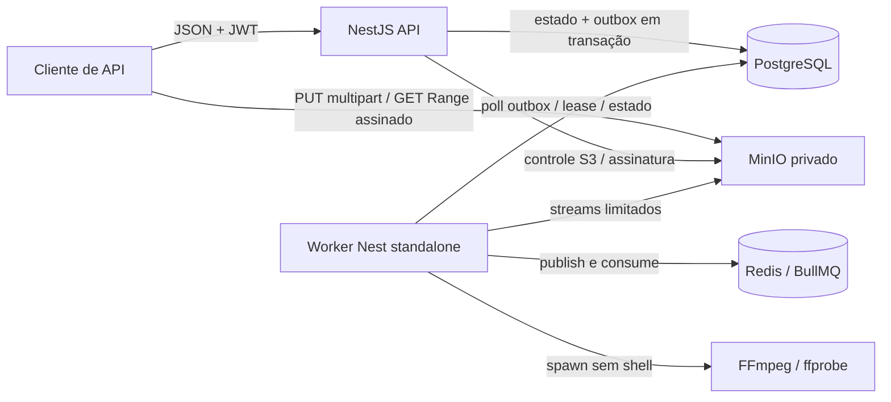

# Phase 03 — Upload e Processamento de Vídeos

## Objective

Entregar upload retomável de até 10.000.000.000 bytes com draft inicial, fila e
worker isolados, metadados/thumbnail, URL única, streaming e download. A
implementação está parcial: os registros datados documentam execuções de
SI-03.1–08, mas a auditoria de 09/11/2026 reabriu os aceites afetados até que a
change `fix-phase-03-audit-findings` produza evidência atual. SI-03.9–15 e a DoD
final permanecem pendentes.

Decisões canônicas: [technical-decisions-phase-03-videos.md](../../decisions/technical-decisions-phase-03-videos.md).
Referências de API/versão: [library-refs.md](library-refs.md).
Publicação e UI permanecem fora do escopo; ready indica processamento concluído.

## Step Implementations

### SI-03.1 — Confirmar baseline e ambiente

**Description:** Estabelecer a revisão e a suíte de referência antes de alterar runtime.

**Technical actions:**

1. Registrar branch feature/* derivada de dev, revisão-base e alterações preexistentes; preservar o port e os arquivos locais.
2. Antes de migrations/testes, preparar instância PostgreSQL descartável em stack de teste separada, sem volumes/conexões dev. Configurar DB_HOST de teste e DB_NAME/DB_DATABASE com o mesmo nome exclusivo. O helper atual usa DB_DATABASE e executa DELETE/DROP; nunca permitir fallback para streamtube. Verificar current_database() nas conexões do helper e do AppModule e abortar se não corresponder ao banco descartável. Usar container de teste sem servidor dev/worker concorrente e credencial sem acesso ao banco dev.
3. Subir serviços existentes no Docker, instalar via npm ci e aplicar migrations somente no banco de teste; verificar readiness. SI-03.1 usa as duas variáveis explicitamente; SI-03.3 consolida o helper e sua proteção permanente.
4. Executar npm run lint antes dos gates, pois contém --fix; registrar eventual diff antes de congelar o candidato. Executar npm test -- --runInBand, npm run test:e2e -- --runInBand, npx tsc --noEmit e lint sem escrita conforme comandos de fechamento; registrar resultados e fingerprint em progress.md.

**Tests:** _(empty — evidência operacional/comandos completos descritos nos critérios deste SI)_

**Dependencies:** none

**Acceptance criteria:**

- Baseline registra revisão, ambiente e quatro exit codes; falha bloqueia início dos SIs funcionais.
- Nenhum dado ou alteração preexistente é removido durante setup.
- Isolamento do helper e AppModule é confirmado antes de DELETE/DROP; variáveis
  divergentes, banco inesperado ou credencial com acesso dev bloqueiam baseline.

---

### SI-03.2 — Preparar dependências e infraestrutura

**Description:** Disponibilizar storage/fila reais e builds reproduzíveis (TD-01/03/09).

**Technical actions:**

1. Instalar versões exatas de library-refs no container e atualizar lockfile; não migrar NestJS/Node como tarefa paralela.
2. Criar Dockerfile.video-worker com FFmpeg/ffprobe e build MinIO do release/commit fixado; registrar versões/digests e validar ffprobe -version.
3. Estender compose.yaml com MinIO, Redis AOF/noeviction, volumes, resource limits, init SDK e migration one-shot; preparar serviço worker para SI-03.9.
4. Adicionar namespaces storage/queue/video e Joi/.env.example, distinguindo endpoint público/interno; tornar comando da API explícito na stack final.
5. Estender o isolamento do banco já estabelecido em SI-03.1 com bucket e prefixo Redis distintos.

**Tests:**

| Artifact | Layer | Test file |
| --- | --- | --- |
| Configuração | Unit: Joi e invariantes | `nestjs-project/src/config/video.config.spec.ts` |
| Stack/bootstrap | Integration: bucket privado, Redis e readiness | `nestjs-project/src/videos/infrastructure.integration-spec.ts` |

**Dependencies:** SI-03.1

**Acceptance criteria:**

- MinIO/Redis/DB ficam saudáveis; init repetido não apaga objetos e encerra com código 0.
- Credenciais/config ausentes impedem bootstrap com diagnóstico sanitizado.
- Restart preserva objetos e jobs; default Compose final serve API e iniciará worker em SI-03.9.

---

### SI-03.3 — Persistir vídeos, sessões e outbox

**Description:** Criar schema aditivo ligado ao canal e regras de unicidade (TD-06/07).

**Technical actions:**

1. Criar entidades Video, VideoUploadSession e VideoProcessingOutbox conforme Data Model, com relação unidirecional Video→Channel.
2. Criar e revisar migration CreateVideos com up/down, FKs, checks, índices únicos e índices de reconciliação.
3. Criar VideoPersistenceModule e repositories de acesso/claims atômicos; não executar chamadas externas dentro de transações.
4. Atualizar helpers de testes e expectativas de migrations para novas tabelas e ordem de cleanup, mantendo isolamento DB_NAME.

**Tests:**

| Artifact | Layer | Test file |
| --- | --- | --- |
| Schema/repositories | Integration: checks, FK, UNIQUE e CAS | `nestjs-project/src/videos/videos.repository.integration-spec.ts` |
| Migrations | Integration: up e rollback aditivo | `nestjs-project/src/database/migrations.integration-spec.ts` |

**Dependencies:** SI-03.1

**Acceptance criteria:**

- Migration em banco vazio cria vídeos ligados a canais; rollback remove somente as tabelas novas.
- Duplicata de public_id e idempotency_key do mesmo canal é rejeitada pelo banco.
- Lease/claim concorrente possui um vencedor; rollback não deixa evento órfão.
- state/expected_parts NULL e canal de sessão divergente do vídeo são rejeitados
  pelo banco; helpers permanentes recusam fallback de ambiente de teste para dev.

---

### SI-03.4 — Integrar storage S3

**Description:** Criar adapter de controle, assinatura e streams sem buffering de arquivo (TD-02/03/05).

**Technical actions:**

1. Criar StorageModule e adapter AWS v3 com clients separados para endpoint interno/público.
2. Implementar operações multipart, ListParts paginado, HEAD, abort/delete e geração de assinaturas por método/tamanho.
3. Implementar download em stream e upload limitado de derivados via lib-storage; adicionar timeout/cancelamento.
4. Configurar bucket/política privada no init SDK. Em MinIO, configurar origens globalmente via MINIO_API_CORS_ALLOW_ORIGIN no serviço, sem PutBucketCors (não implementado no release). Em AWS S3, usar CORS por bucket. Testar preflight permitido/proibido, PUT/GET/HEAD e exposição de ETag/Content-Range/Accept-Ranges; redigir contratos de erro do adapter.

**Tests:**

| Artifact | Layer | Test file |
| --- | --- | --- |
| Storage adapter | Integration: multipart real, headers, assinatura e privacidade | `nestjs-project/src/storage/storage.service.integration-spec.ts` |

**Dependencies:** SI-03.2

**Acceptance criteria:**

- UploadPart com tamanho diferente do assinado é rejeitado pelo MinIO.
- Bucket recusa leitura anônima; assinatura pública funciona sem editar o host.
- Listagem/abort/HEAD refletem bytes reais e métodos GET/HEAD assinados são distintos.
- Preflight real valida origens permitidas/proibidas; MinIO usa CORS global sem
  PutBucketCors. Teste MinIO não é apresentado como execução de integração AWS.

---

### SI-03.5 — Iniciar drafts e autorizar ownership

**Description:** Pré-cadastrar vídeo com identidade, quota e replay seguro (TD-06/07/08).

**Technical actions:**

1. Adicionar lookup de canal por userId em ChannelsService e usar o módulo dono da relação.
2. Implementar normalização/hash do request e Idempotency-Key, reserva de admissão e criação atômica draft/sessão antes do S3; reserva cobre processing e cleanup pendente.
3. Gerar public_id crypto com UNIQUE e retry transacional até três colisões; produzir URL canônica.
4. Implementar provisioning initiating→uploading com claim e falha recuperável, sem manter transação durante S3.

**Tests:**

| Artifact | Layer | Test file |
| --- | --- | --- |
| Upload initiation | Unit: validações, colisão, ownership e replay | `nestjs-project/src/videos/video-upload.service.spec.ts` |
| Draft/reservas | Integration: concorrência, idempotência e quota | `nestjs-project/src/videos/video-upload.service.integration-spec.ts` |
| Canal lookup | Integration: usuário→canal real | `nestjs-project/src/channels/channels.service.integration-spec.ts` |

**Dependencies:** SI-03.3, SI-03.4

**Acceptance criteria:**

- Antes da primeira chamada multipart já existe draft vinculado ao canal do JWT.
- Replay idêntico retorna mesmo vídeo; body diferente com mesma key é conflito.
- Criações concorrentes não ultrapassam quotas e três colisões nunca persistem URL duplicada.
- Replay em initiating tem schema/Retry-After definidos; normalização equivalente
  não conflita. Quota inclui processing/cleanup até liberação confirmada.

---

### SI-03.6 — Controlar retomada e conclusão de uploads

**Description:** Autorizar partes e verificar upload real antes de iniciar processamento (TD-02/06).

**Technical actions:**

1. Implementar assinatura em lotes de até 20 partes, renovação, listagem de partes e prazo fixo de sessão.
2. Implementar complete com CAS/operation token, ListParts paginado e validação de sequência/tamanhos/total.
3. Validar HEAD após complete e persistir sessão completed + vídeo processing + outbox única na mesma transação.
4. Implementar abort idempotente e intenção de limpeza, impedindo concorrência inválida com complete.

**Tests:**

| Artifact | Layer | Test file |
| --- | --- | --- |
| Protocolo upload | Unit: bordas, estados e validação | `nestjs-project/src/videos/video-upload.service.spec.ts` |
| Multipart real | Integration: retomada, complete e abort concorrentes | `nestjs-project/src/videos/video-upload.service.integration-spec.ts` |

**Dependencies:** SI-03.5

**Acceptance criteria:**

- Parte interrompida pode ser reenviada sem reenviar partes concluídas.
- Parte faltante não enfileira job; total divergente fecha e limpa sessão.
- Complete repetido produz um evento lógico; Redis indisponível não perde a outbox.
- TTL de URL nunca excede sessão; PUT rejeitado permite correção. Completion
  previamente aceito é protegido do sweep e completed admite replay após TTL.

---

### SI-03.7 — Recuperar sessões e publicar outbox

**Description:** Garantir transição confiável apesar de crashes entre DB/S3/fila (TD-06).

**Technical actions:**

1. Criar dispatcher com claim SKIP LOCKED, publish fora de transação, jobId estável e backoff persistido.
2. Criar reconciliador de initiating/completing com HEAD/ListMultipartUploads/ListParts e operation_token; repetir validação completa de partes e resolver expiração concorrente/resultado de commit desconhecido antes de limpar objetos.
3. Implementar varredura de sessões expiradas/aborted e multipart órfão, preservando sources completed.
4. Testar failpoints entre efeitos externos e commits; registrar logs por videoId/eventId sem URL assinada.

**Tests:**

| Artifact | Layer | Test file |
| --- | --- | --- |
| Outbox | Integration: Redis indisponível e publish duplicado | `nestjs-project/src/videos/processing/outbox.integration-spec.ts` |
| Sessões | Integration: crash em create/complete e cleanup | `nestjs-project/src/videos/upload-reconciler.integration-spec.ts` |

**Dependencies:** SI-03.6, SI-03.2

**Acceptance criteria:**

- Crash após complete S3 é recuperado para processing com apenas um evento.
- HEAD 5xx não causa exclusão nem é interpretado como objeto ausente.
- Retomada do Redis drena a outbox sem exigir nova ação do cliente.
- Crash antes de validar partes não completa subconjunto: recuperação revalida
  integralmente e preserva retomada no prazo; incomplete após TTL expira sem job.

---

### SI-03.8 — Expor controle HTTP e contratos (backend-integration)

**Route:** POST /videos (e rotas de controle relacionadas)

**Description:** Conectar os serviços à API preservando auth e erros existentes (TD-02/08/09).

**Test Specs:** see `nestjs-project/specs/video-upload.plan.md`

**Technical actions:**

1. Criar DTOs/request-response e VideosController para POST /videos, partes, consulta, completion, abort e GET canônico.
2. Aplicar ownership em todas as operações e tratar respostas idempotentes/Location/Retry-After conforme API Contracts.
3. Aplicar limite JSON 64KiB apenas nas rotas de vídeos, overrides de throttle e catálogo de erros; preservar endpoints auth.
4. Registrar módulo na API e enriquecer Swagger; export não deve carregar processor/dispatcher.

**Tests:**

| Artifact | Layer | Test file |
| --- | --- | --- |
| Controller/DTO | Unit: roteamento, DTO e serialização | `nestjs-project/src/videos/videos.controller.spec.ts` |
| DI API | Integration: grafo real sem consumidores | `nestjs-project/src/videos/videos.module.integration-spec.ts` |

**Dependencies:** SI-03.6, SI-03.7

**Acceptance criteria:**

- Rotas retornam os status e bodies especificados; cliente não escolhe dono/key/uploadId.
- JWT inválido retorna 401, outro dono recebe 404 e auth mantém limite anterior.
- OpenAPI contém DTOs/erros novos e sua exportação não consome fila.

---

### SI-03.9 — Inicializar worker separado

**Description:** Executar consumidor e manutenção em processo próprio (TD-01/06/09).

**Technical actions:**

1. Criar src/video-worker.ts e VideoWorkerModule standalone com config/DB/storage/BullMQ próprios, sem AppModule.
2. Adicionar npm scripts build/start:worker e comando Compose; iniciar dispatcher/reconciliador somente nesse entrypoint.
3. Configurar concurrency 1, listeners de erro, shutdown/heartbeat e disponibilidade dos binários e disco.
4. Configurar processo que aguarda jobs e não executa teste/servidor HTTP no worker.

**Tests:**

| Artifact | Layer | Test file |
| --- | --- | --- |
| Worker wiring | Integration: boot, shutdown e isolamento API | `nestjs-project/src/videos/processing/video-worker.integration-spec.ts` |

**Dependencies:** SI-03.2, SI-03.7

**Acceptance criteria:**

- docker compose up sobe worker consumindo fila real em container próprio.
- API continua respondendo durante job e encerra sem depender de FFmpeg.
- Shutdown fecha conexões; kill forçado deixa trabalho recuperável por lease.

---

### SI-03.10 — Extrair metadados e produzir mídia

**Description:** Processar conteúdo MP4 real com recursos limitados (TD-04/05).

**Technical actions:**

1. Implementar download source para diretório por tentativa via stream e reserva de disco.
2. Executar ffprobe com campos permitidos, protocolos locais, timeout e stdout limitado; validar formato/codec/duração e seleção de streams. Decodificar integralmente os streams selecionados para saída nula, com erros fatais e deadline.
3. Executar remux MP4 faststart e extração JPEG sem shell, mapeando explicitamente os mesmos índices validados, com deadlines e interrupção por perda de lease.
4. Publicar derivados por tentativa com buffers limitados, confirmar HEAD e finalizar ready por CAS. Se houver dúvida sobre o commit, reler estado/keys; nunca apagar objeto referenciado pelo vencedor. DB indisponível adia cleanup.

**Tests:**

| Artifact | Layer | Test file |
| --- | --- | --- |
| Processamento | Unit: classificação de erros e argumentos seguros | `nestjs-project/src/videos/processing/video-processor.spec.ts` |
| FFmpeg + storage | Integration: vídeo válido/corrompido, thumbnail e faststart | `nestjs-project/src/videos/processing/video-processor.integration-spec.ts` |

**Dependencies:** SI-03.9

**Acceptance criteria:**

- Vídeo MP4 suportado torna-se ready com duração/dimensões/codecs e JPEG real.
- Codec não aceito termina error sem publicar mídia parcial como ready.
- Tentativa que perdeu lease não altera estado nem sobrescreve derivados vencedores.
- Decode integral detecta corrupção posterior ao frame inicial; erro detectado é
  INVALID_VIDEO e track/codec não aceito é UNSUPPORTED_VIDEO. Índices e metadata
  seguem contrato explícito. Commit com resposta perdida nunca apaga vencedor.

---

### SI-03.11 — Concluir retry e recuperação do processamento

**Description:** Evitar estados presos e resultados obsoletos (TD-06).

**Technical actions:**

1. Implementar heartbeat/claim com fencing e orçamento de 3 tentativas persistido no DB.
2. Reconciliar jobs ausentes/stalled/failed com outbox mantida até terminal; distinguir indisponibilidade de ausência.
3. Persistir backoff/liberação por CAS nas falhas transitórias; adiar entrega sem claim e recuperar job terminal sem vídeo terminal. Finalizar falhas definitivas/orçamento DB esgotado em error e tornar ready/error idempotentes em reentregas.
4. Limpar scratch/prefixos perdedores assim que terminal e ownership forem confirmados; fallback para órfãos abandonados há 24h. Nunca remover tentativa ativa/vencedora. Liberar reserva somente após limpeza confirmada.

**Tests:**

| Artifact | Layer | Test file |
| --- | --- | --- |
| Recovery | Integration: crash, duplicate, stale fencing e Redis restart | `nestjs-project/src/videos/processing/processing-recovery.integration-spec.ts` |

**Dependencies:** SI-03.10

**Acceptance criteria:**

- Job perdido no Redis volta a ser publicado sem reiniciar orçamento DB.
- Três falhas de processamento levam a error com failureCode persistido.
- Reentrega de ready não reprocessa nem muda URL/thumbnail vencedora.
- Cleanup pendente mantém reserva; conclusão de limpeza libera uma vez sem
  remover originais completed. DB indisponível impede exclusão com ownership incerto.
- Lease ocupada não produz sucesso falso; falha transitória libera lease e respeita backoff DB; terceira tentativa ativa nunca é encerrada pelo sweep.

---

### SI-03.12 — Entregar streaming, thumbnail e download

**Route:** GET /videos/:publicId/stream (e download/thumbnail/HEAD)

**Description:** Expor URLs estáveis privadas com transferência direta do storage (TD-05/08).

**Test Specs:** see `nestjs-project/specs/video-delivery.plan.md`

**Technical actions:**

1. Adicionar rotas GET e HEAD de stream/download/thumbnail com autenticação/ownership/status.
2. Gerar redirects 307 no-store com operação assinada correta e disposition segura.
3. Documentar Range, expiração/renovação e erro storage no Swagger e runbook de cliente backend.

**Tests:**

| Artifact | Layer | Test file |
| --- | --- | --- |
| Media delivery | Unit: autorização, estado e headers | `nestjs-project/src/videos/video-delivery.service.spec.ts` |
| Range storage | Integration: 200/206/416, HEAD e disposition | `nestjs-project/src/videos/video-delivery.integration-spec.ts` |

**Dependencies:** SI-03.8, SI-03.11

**Acceptance criteria:**

- Cliente segue 307 e recebe 206 de um trecho sem download completo.
- HEAD não baixa corpo e usa assinatura HEAD válida.
- Download preserva original e rascunhos/outros donos não obtêm URLs.

---

### SI-03.13 — Validar fluxo completo e regressões (backend-integration)

**Description:** Exercitar API, DB, fila, storage e worker juntos (TD-09).

**Test Specs:** see `nestjs-project/specs/video-processing.plan.md`

**Technical actions:**

1. Implementar cenários e2e das specs de upload/delivery/processing com infraestrutura real e fixtures pequenas.
2. Integrar lifecycle de teste isolado e cleanup sem atingir desenvolvimento; ajustar regressões de auth/migrations.
3. Executar testes com --runInBand, armazenar resultados por SI e remover mocks indevidos nos contratos externos.

**Tests:** _(empty — cenários e2e definidos nas três specs externas; suites são executadas neste SI)_

**Dependencies:** SI-03.12

**Acceptance criteria:**

- Uma sessão percorre draft→processing→ready usando serviços reais.
- Falha definitiva percorre processing→error com contrato HTTP consistente.
- Suíte auth existente permanece verde e dados de desenvolvimento intactos.

---

### SI-03.14 — Comprovar upload de 10GB e desempenho

**Description:** Produzir evidência material do limite e da ausência de bloqueio (TD-02/09).

**Technical actions:**

1. Criar cliente/script de ensaio containerizado com streaming em blocos, concorrência limitada e retomada.
2. Materializar duas fixtures: MP4 de exatamente 10GB para a fronteira e MP4 representativo com pelo menos 9GB de payload audiovisual real, até 10GB totais. Registrar hash/tamanho/duração/composição e transferir/processar ambos; padding free é permitido somente na fixture de fronteira.
3. Renovar JWT por refresh token rotation; medir API continuamente no upload e processamento até terminal, com métricas por etapa; confirmar recursos worker, Range e download.
4. Salvar relatório sanitizado em evidence/ com ambiente, revisão, comandos, métricas e critérios aprovados/reprovados.

**Tests:** _(empty — evidência operacional/comandos completos descritos nos critérios deste SI)_

**Dependencies:** SI-03.13

**Acceptance criteria:**

- 10.000.000.000 bytes foram transferidos e processados com thumbnail e mídia pronta.
- Retomada não reenvia partes já confirmadas e a API atende os alvos registrados.
- Relatório apresenta números reais; falha de recursos ou métrica mantém SI pendente.
- Fronteira 10GB e mídia representativa ≥9GB de payload são ensaios distintos;
  cada etapa upload/processing cumpre métricas, JWT renova sem alterar TTL auth.

---

### SI-03.15 — Fechar qualidade e documentação

**Description:** Reconciliar entrega inteira com critérios e evidências reais (TD-09).

**Technical actions:**

1. Atualizar AGENTS raiz/backend com módulos, endpoints, configuração e comandos efetivos; atualizar README/runbook.
2. Exportar OpenAPI e sincronizar cópia/tipos gerados do consumidor conforme script existente, sem criar interface de vídeo.
3. Rodar npm run lint (autofix) antes de congelar o candidato; depois npm test -- --runInBand, npm run test:e2e -- --runInBand, npx tsc --noEmit e lint sem escrita, com fingerprint idêntico antes/depois. Mudança na árvore invalida checks afetados e exige nova execução.
4. Revisar checklist R01..R12, progress e git diff; preparar integração feature→dev e eventual publicação no fork conforme autorização.

**Tests:** _(empty — evidência operacional/comandos completos descritos nos critérios deste SI)_

**Dependencies:** SI-03.14

**Acceptance criteria:**

- Quatro gates técnicos encerram com código 0 na revisão final registrada.
- Autofix antecede os gates; lint final --no-fix e fingerprint antes/depois
  comprovam que os quatro resultados correspondem à mesma árvore.
- Nenhuma capacidade é marcada pronta sem evidência; AGENTS corresponde ao código.
- Alteração permanece em feature/*; não há commit direto na main.

---


## Unidades históricas da remediação executada em 17/11/2026

As unidades SI-03.16–27 abaixo preservam exatamente a identidade publicada em
`progress.md`. Seus resultados são históricos, datados de 17/11/2026, e não
certificam o candidato reaberto pela auditoria de 18/11.

### SI-03.16 — Encapsular persistência e recuperar provisionamento

- **Objective:** retirar SQL/transações dos services e recuperar provisioning cercado.
- **Files:** `src/videos/persistence/`, upload/reconciler/processor e stack de teste.
- **Steps:** criar operações tipadas/CAS; restringir banco de teste; recuperar initiating.
- **Tests:** arquitetura, repositórios, PostgreSQL e replay concorrente.
- **Acceptance:** services sem SQL/DataSource; role restrita; vencedor persistido por CAS.
- **Dependencies:** SI-03.1, SI-03.3.
- **Historical result (17/11/2026):** executado; evidência e limitações em `progress.md`.

### SI-03.17 — Persistir obrigação durável de cleanup

- **Objective:** registrar intenção e confirmação duráveis de limpeza e quota.
- **Files:** migration/repository de cleanup, upload e processamento.
- **Steps:** criar obrigação, claim cercado, backoff e confirmação idempotente.
- **Tests:** migration up/down, concorrência, falhas e rechecagem.
- **Acceptance:** efeito remoto pendente sobrevive a crash e quota só sai após confirmação.
- **Dependencies:** SI-03.16, SI-03.5, SI-03.7.
- **Historical result (17/11/2026):** executado; não cobre a unificação exigida por F05/F06.

### SI-03.18 — Supervisionar streams de storage

- **Objective:** cancelar e drenar streams quando lease/deadline falhar.
- **Files:** adapter S3, processor e testes de stream.
- **Steps:** propagar sinais; limitar buffers; destruir requests e subprocessos.
- **Tests:** stream pendente, perda de lease e falha de upload/download.
- **Acceptance:** nenhum I/O continua depois do fence e recursos são liberados.
- **Dependencies:** SI-03.17, SI-03.4, SI-03.10, SI-03.11.
- **Historical result (17/11/2026):** executado para mídia; controle S3 ficou sem deadline global.

### SI-03.19 — Aplicar deadline total e perda de lease

- **Objective:** aplicar orçamento total ao processamento e impedir commit obsoleto.
- **Files:** processor, runner FFmpeg, leases e recovery.
- **Steps:** combinar sinais; heartbeat; fence de commit; cleanup conservador.
- **Tests:** timeout, resposta DB perdida e tentativa concorrente.
- **Acceptance:** tentativa sem lease não publica nem remove artefato vencedor.
- **Dependencies:** SI-03.17, SI-03.8, SI-03.12.
- **Historical result (17/11/2026):** executado e provado nos perfis condicionais históricos.

### SI-03.20 — Integrar cleanup terminal e efeitos tardios

- **Objective:** convergir resíduos após abort/expire/erro e efeitos remotos tardios.
- **Files:** maintenance, upload reconciler, processing recovery e storage.
- **Steps:** varrer multiparts/objetos/scratch; preservar referências vencedoras; reagendar falhas.
- **Tests:** late PUT, crash, delete/list/head/rm e idempotência.
- **Acceptance:** convergência sem apagar fonte/derivados referenciados.
- **Dependencies:** SI-03.16, SI-03.2, SI-03.9.
- **Historical result (17/11/2026):** executado parcialmente; autoridades duplicadas motivaram F05/F06.

### SI-03.21 — Saturar backoff da outbox

- **Objective:** impedir overflow e manter retry finito/observável.
- **Files:** outbox repository/dispatcher e testes.
- **Steps:** saturar cálculo, usar relógio DB e preservar token de claim.
- **Tests:** limite, concorrência, publish perdido e recuperação.
- **Acceptance:** `next_attempt_at` permanece válido e publicação é idempotente.
- **Dependencies:** SI-03.18, SI-03.19, SI-03.20, SI-03.13.
- **Historical result (17/11/2026):** executado e validado no candidato histórico.

### SI-03.22 — Classificar mídia e restringir subprocessos

- **Objective:** validar perfil suportado e executar FFmpeg sem shell.
- **Files:** media inspector/runner, processor e fixtures.
- **Steps:** selecionar streams explícitos; validar codec/pixel format/eixos; limitar processo.
- **Tests:** mídia válida, streams extras, portrait, corrupção e timeout.
- **Acceptance:** apenas MP4 H.264 yuv420p e até um AAC nos limites por eixo.
- **Dependencies:** SI-03.21, SI-03.14, SI-03.15.
- **Historical result (17/11/2026):** executado; documentação pública ficou ampla demais.

### SI-03.23 — Corrigir parser, expiração e contrato HTTP

- **Objective:** alinhar parsing, TTL, relógio DB e estados HTTP.
- **Files:** bootstrap HTTP, controller/DTOs, upload service/repository e e2e.
- **Steps:** parser dedicado; transições semânticas; precedência terminal.
- **Tests:** MIME, limites, skew, expiry, replay e completion.
- **Acceptance:** entradas inválidas não causam efeitos e estados vêm do PostgreSQL.
- **Dependencies:** SI-03.22.
- **Historical result (17/11/2026):** executado parcialmente; F08–F11 reabriram contratos.

### SI-03.24 — Endurecer bootstrap, readiness e logs

- **Objective:** comprovar storage privado, worker pronto e logs sanitizados.
- **Files:** bootstrap storage, worker heartbeat, Compose e logging.
- **Steps:** validar policy/CORS; probe de fila; sanitizar contexto.
- **Tests:** policies, readiness, restart e captura de logs.
- **Acceptance:** falha de dependência torna unhealthy sem vazar credenciais.
- **Dependencies:** SI-03.23.
- **Historical result (17/11/2026):** executado parcialmente; N04/N06/N07 permanecem.

### SI-03.25 — Reconciliar documentação e mapa de provas

- **Objective:** alinhar decisões, plano, runbook, OpenAPI e testes.
- **Files:** `docs/`, README/AGENTS, `openapi.json` e test plans.
- **Steps:** revisar referências; mapear requisitos; regenerar contrato.
- **Tests:** links, lint semântico, Swagger e tipos gerados.
- **Acceptance:** evidência pública autossuficiente e sem fonte ignorada obrigatória.
- **Dependencies:** SI-03.24.
- **Historical result (17/11/2026):** executado, mas a auditoria achou conflito de SI e OpenAPI.

### SI-03.26 — Reexecutar os dois grandes ensaios

- **Objective:** provar fronteira exata e carga audiovisual representativa.
- **Files:** harness, relatórios e evidências de ensaio.
- **Steps:** preflight; upload/refresh/resume; processing/delivery; métricas.
- **Tests:** 10.000.000.000 bytes e mídia ≥9.000.000.000 bytes.
- **Acceptance:** hashes, mídia e SLOs da fase atendidos.
- **Dependencies:** SI-03.25.
- **Historical result (17/11/2026):** dois ensaios passaram; pausa JWT contaminou a leitura de latência.

### SI-03.27 — Validar o candidato completo

- **Objective:** congelar árvore e executar DoD completo sem escrita.
- **Files:** manifesto, progresso, checklist e evidências finais.
- **Steps:** fingerprint; suites/perfis/tsc/lint; comparar árvore.
- **Tests:** quatro gates e dois perfis condicionais.
- **Acceptance:** candidato idêntico antes/depois e resultados ligados ao manifesto.
- **Dependencies:** SI-03.26.
- **Historical result (17/11/2026):** gates históricos passaram; não estavam ligados ao novo candidato.

## Unidades correntes da auditoria de 18/11/2026

### SI-03.28 — Reabrir plano e execução reproduzível

- **Objective:** reconciliar SI-03.16–27 e tornar a stack de teste standalone.
- **Files:** plano/contexto/validação/progresso/runbook/README/AGENTS e Compose.
- **Steps:** corrigir identidades; adicionar migrations; validar links e comandos.
- **Tests:** lint semântico, `compose config`, sync idempotente e paths.
- **Acceptance:** F01–F04/N08–N10 rastreáveis sem marcar runtime novo.
- **Dependencies:** SI-03.1–27 históricos.
- **Status:** concluída e verificada na remediação corrente.

### SI-03.29 — Unificar cleanup terminal e autoridade de quota

- **Objective:** fazer uma obrigação durável coordenar cleanup e liberação de quota.
- **Files:** cleanup repository/coordinator, maintenance, processor e integrações.
- **Steps:** claims tipados; branching terminal; remover cleaners/liberação duplicados.
- **Tests:** PostgreSQL/MinIO reais, concorrência, efeitos tardios e EXPLAIN/migration.
- **Acceptance:** F05/F06 integralmente provados e vencedores preservados.
- **Dependencies:** SI-03.28.
- **Status:** concluída e verificada na remediação corrente.

### SI-03.30 — Cercar provisionamento, relógio DB, completion e TTL

- **Objective:** eliminar corridas e decisões temporais do relógio do processo.
- **Files:** upload repository/service, provisionador e reconciler.
- **Steps:** UPDATE RETURNING; provisionador compartilhado; CAS e expiry semântico.
- **Tests:** interleaving real, skew, takeover, TTL e regressões de upload.
- **Acceptance:** F07–F09; nunca abortar vencedor nem retornar estado não persistido.
- **Dependencies:** SI-03.28, SI-03.29.
- **Status:** concluída e verificada na remediação corrente.

### SI-03.31 — Corrigir JSON de controle e OpenAPI

- **Objective:** tornar transporte e documento OpenAPI fiéis ao runtime.
- **Files:** bootstrap, pipe/DTO/controller, Swagger, contrato e tipos frontend.
- **Steps:** JSON estrito; DTOs; security `access-token`; regeneração oficial.
- **Tests:** Supertest, documento em memória, export e typecheck.
- **Acceptance:** F10/F11 e 12 operações documentadas sem refs quebradas.
- **Dependencies:** SI-03.30.
- **Status:** concluída e verificada na remediação corrente.

### SI-03.32 — Limitar S3 e recuperar resultados ambíguos

- **Objective:** aplicar deadlines/cancelamento a todo I/O de controle.
- **Files:** config/storage adapter, upload, reconciler e cleanup.
- **Steps:** NodeHttpHandler; sinais por operação; reconciliação após timeout mutável.
- **Tests:** encaminhamento, endpoint pendente e integrações MinIO.
- **Acceptance:** F12; request termina no orçamento sem rollback remoto presumido.
- **Dependencies:** SI-03.29, SI-03.30.
- **Status:** concluída e verificada na remediação corrente.

### SI-03.33 — Corrigir readiness, portabilidade, policy, logs e docs

- **Objective:** fechar N02–N08/N10/N11 na operação real.
- **Files:** worker, Compose, bootstrap, logging, README/runbook/decisões/referências.
- **Steps:** probe Redis; remover cpuset; URL pareada; wildcard IAM; logs sanitizados.
- **Tests:** Compose, policy, porta não padrão, readiness e captura de logs.
- **Acceptance:** infraestrutura portátil, privada, observável e documentação precisa.
- **Dependencies:** SI-03.28, SI-03.32.
- **Status:** concluída e verificada na remediação corrente.

### SI-03.34 — Executar regressões e gates funcionais

- **Objective:** provar F04–F12 e N02–N08 no ambiente standalone.
- **Files:** suites, relatórios e progresso.
- **Steps:** recriar stack; regressões; suites padrão; perfis condicionais; tsc/lint.
- **Tests:** todos os comandos da DoD no container.
- **Acceptance:** exits 0, contagens atuais e falhas preservadas até correção.
- **Dependencies:** SI-03.29–33.
- **Status:** concluída e verificada na primeira passagem corrente (316/92/14/2); a certificação congelada pertence à SI-03.36.

### SI-03.35 — Repetir ensaios grandes

- **Objective:** medir atividade separada da pausa JWT e repetir ambos os ensaios.
- **Files:** harness e evidências de large trials.
- **Steps:** adaptar métricas; preflight; fronteira; audiovisual; validar relatórios.
- **Tests:** relatório sintético e duas execuções materiais.
- **Acceptance:** N01/N02/N11/N12 com hashes, digests e SLOs.
- **Dependencies:** SI-03.34.
- **Status:** concluída em 20/11/2026; ambos os ensaios correntes e seus artefatos públicos foram validados.

### SI-03.36 — Certificar candidato imutável

- **Objective:** reconciliar artefatos, congelar candidato e repetir DoD.
- **Files:** documentação pública, manifests e checklist.
- **Steps:** secret scan; candidate-before; gates; candidate-after; comparação.
- **Tests:** suites/perfis/tsc/lint sem escrita e manifesto byte a byte.
- **Acceptance:** F01–F03/N09/N10 ligados à mesma árvore aprovada.
- **Dependencies:** SI-03.34, SI-03.35.
- **Status:** em execução; documentação reconciliada, manifesto e gates congelados ainda pendentes.

### SI-03.37 — Preparar e publicar via Git Flow

- **Objective:** integrar e publicar somente após autorizações explícitas posteriores.
- **Files:** checklist e histórico Git/remoto.
- **Steps:** preparar comandos; após autorização, commits/rebase ou merge; após nova autorização, push/verificação.
- **Tests:** gates afetados, manifesto integrado e inspeção do fork público.
- **Acceptance:** sem commit em `main`, SHA/URL verificados e nenhum material privado.
- **Dependencies:** SI-03.36 com candidato aprovado; autorização separada para commit e para push.
- **Status:** preparação pendente; mutações Git/publicação bloqueadas por autorização.

## Technical Specifications

### Architecture



`VideosModule` (API) importa ChannelsModule, VideoPersistenceModule e
StorageModule. `VideoWorkerModule` importa persistência/storage/queue e executa
dispatcher, reconciliador e processor; não importa AuthModule/AppModule nem abre
HTTP. API persiste outbox, sem depender de Redis para aceitar uma conclusão.
FFmpeg nunca executa na API. OpenAPI export usa apenas o grafo da API.

### Data Model

Migration única `CreateVideos` cria três tabelas, índices e checks. TypeORM com
`synchronize:false`. UUID/timestamptz e nomes snake_case seguem a base. `bigint`
é convertido explicitamente: valores públicos de tamanho ficam abaixo de 2^53;
não deixar driver retornar string em contrato que promete number.

#### videos

| Coluna | Tipo e restrições | Uso |
| --- | --- | --- |
| id | uuid PK | Identidade interna |
| public_id | varchar(22) NOT NULL UNIQUE | Token base64url imutável |
| channel_id | uuid NOT NULL FK channels(id), RESTRICT; índice | Dono, relação unidirecional ManyToOne |
| title | varchar(200) NOT NULL | Trim; 1–200 caracteres |
| original_filename | varchar(255) NOT NULL | Apenas basename sanitizado para download |
| status | varchar(16) NOT NULL DEFAULT draft, CHECK | draft, processing, ready, error |
| size_bytes | bigint NOT NULL CHECK 1..10000000000 | Tamanho esperado, validado no storage |
| source_key | text NOT NULL UNIQUE | Gerada a partir do UUID |
| stream_key, thumbnail_key | text NULL | Somente tentativa vencedora |
| duration_ms | bigint NULL CHECK >0 quando preenchido | Duração extraída |
| metadata | jsonb NULL | VideoMetadata tipado no contrato público abaixo |
| failure_code | varchar(64) NULL | Erro sanitizado, nunca stderr bruto |
| processing_attempts | int NOT NULL DEFAULT 0 CHECK 0..3 | Orçamento persistente |
| attempt_id | uuid NULL | Token de fencing da tentativa |
| lease_until | timestamptz NULL | Claim/heartbeat com relógio DB |
| processing_next_attempt_at | timestamptz NULL | Backoff persistido; claim exige prazo atingido |
| processing_started_at, processed_at | timestamptz NULL | Diagnóstico |
| created_at, updated_at | timestamptz NOT NULL | Auditoria |

Check ready exige stream_key, thumbnail_key, duration_ms e metadata; check error
exige failure_code. Índice parcial em status processing/lease_until para sweep.
Não adicionar `Channel.videos` nesta fase para preservar metadados de testes antigos.

#### video_upload_sessions

| Coluna | Tipo e restrições | Uso |
| --- | --- | --- |
| id | uuid PK | Sessão |
| video_id | uuid UNIQUE NOT NULL FK videos(id), CASCADE | Uma sessão por draft inicial |
| channel_id | uuid NOT NULL FK channels(id), RESTRICT | Reserva e idempotência |
| idempotency_key | uuid NOT NULL | UNIQUE(channel_id,idempotency_key) |
| request_hash | varchar(64) NOT NULL | Hash do request normalizado |
| storage_upload_id | text NULL | Não retornado como autoridade do cliente |
| state | varchar(16) NOT NULL CHECK | initiating, uploading, completing, completed, aborted, expired |
| expected_parts | int NOT NULL CHECK 1..150 | ceil(size/67108864) |
| expires_at | timestamptz NOT NULL | Criação +24h, não prolonga na renovação |
| completion_started_at | timestamptz NULL | Aceite do ciclo completing atual; recuperação não renova |
| quota_released_at | timestamptz NULL | NULL retém admissão durante processing/cleanup pendente |
| operation_token, operation_until | uuid NULL, timestamptz NULL | Serializar create/complete/abort sem lock de rede |
| last_error_code | varchar(64) NULL | Falha de controle recuperável/terminal |
| created_at, updated_at | timestamptz NOT NULL | Diagnóstico/reconciliação |

Índices (channel_id,state), (state,expires_at) e parcial (channel_id) WHERE
quota_released_at IS NULL. UNIQUE videos(id,channel_id) e FK composta
session(video_id,channel_id)→videos(id,channel_id) impedem divergência de dono.
Reserva usa advisory transaction lock comum a create/liberação: no máximo 2 por
canal e 10 globais com quota_released_at NULL, incluindo uploads, processing e
cleanup pendente. Check ocorre na transação do draft; replay não consome reserva.
Liberação exige ready/error (sessão completed), ou aborted/expired, e limpeza
confirmada de multipart/temporários/derivados não vencedores. Falha de cleanup
retém reserva e gera diagnóstico; reconciliador libera sem ação do cliente.
Preservar original de sessão completed (inclusive vídeo error) e derivados
vencedores. Quotas limitam trabalho pendente, não bytes históricos: não há quota
vitalícia/exclusão nesta fase. Runbook deve declarar capacidade/ocupação MinIO,
alerta de espaço e suspensão operacional de novas admissões, sem prometer storage
ilimitado. Scratch ≥40GiB é separado do volume que acomoda originais/derivados.

#### video_processing_outbox

| Coluna | Tipo e restrições | Uso |
| --- | --- | --- |
| id | uuid PK | eventId |
| video_id | uuid NOT NULL FK videos(id), CASCADE | Vídeo |
| processing_version | int NOT NULL DEFAULT 1 | UNIQUE(video_id,processing_version) |
| event_type | varchar(64) NOT NULL | video.processing.requested.v1 |
| payload | jsonb NOT NULL | Schema versionado abaixo |
| publish_attempts | int NOT NULL DEFAULT 0 | Tentativas de transporte |
| next_attempt_at | timestamptz NOT NULL | Backoff até 5min |
| lock_token, locked_until | uuid NULL, timestamptz NULL | Claim curto de dispatcher |
| published_at, finalized_at | timestamptz NULL | Publicado não significa processado |
| created_at | timestamptz NOT NULL | Ordenação |

Índice parcial (next_attempt_at) WHERE finalized_at IS NULL. Não apagar na
publicação: reconciliador usa a linha para repor job perdido até estado terminal.

### API Contracts

Base sem `/api`. `:publicId` deve ser base64url de 22 caracteres. Todas as rotas
exigem JWT e propriedade; `channelId`, `userId`, keys e uploadId nunca são aceitos
no body. Sem propriedade: 404; JWT inválido/ausente: 401 padrão Nest. Bodies JSON
≤64KiB, whitelist/forbidNonWhitelisted/transform existentes. Não usar interceptor
multipart/Multer nem body de vídeo no Nest. Timestamps ISO UTC; tamanhos em bytes.

`VideoView = {id:uuid, publicId:string, title:string, status:'draft'|'processing'|
'ready'|'error', sizeBytes:number, durationMs:number|null, metadata:VideoMetadata|null,
failureCode:string|null, canonicalUrl:string, createdAt:string, updatedAt:string}`.
VideoView e DTOs de estado não contêm bucket, key, uploadId, attemptId ou query
assinada. URLs temporárias aparecem somente na resposta de assinatura de partes
e no Location das rotas de mídia, com Cache-Control: no-store.

`VideoMetadata = {format:'mp4', videoCodec:'h264', audioCodec:'aac'|null,
width:integer, height:integer, fps:{numerator:integer,denominator:integer}}`.
Dimensões positivas dentro do limite; fps racional positivo, denominator >0,
derivado de avg_frame_rate (não inferir CFR); 0/0 ou valor não finito é INVALID_VIDEO.
Duração é Math.round(durationSeconds * 1000), inteira positiva e segura; rejeitar
zero/não finito/fora de Number.MAX_SAFE_INTEGER. Em draft/processing, duração e
metadata ficam null; publicar juntos na transação ready.

Política de streams: exatamente um vídeo H.264 yuv420p não attached_pic e zero
ou um áudio AAC. Outros tracks/streams, inclusive capa/legendas/dados, resultam em
UNSUPPORTED_VIDEO. Usar índices ffprobe explícitos e iguais na validação, remux e
thumbnail. Decodificar integralmente vídeo/áudio selecionados para saída nula:
erro de demux/decode detectado é INVALID_VIDEO sem retry; não promete detectar
defeito visual semanticamente válido. Decode timeout 60min dentro do deadline
total 90min; timeout é PROCESSING_TIMEOUT. Remux continua sem recodificação;
deadline total prevalece sobre timeouts individuais de subprocessos.

#### POST /videos (SI-03.8)

**Request headers:** Authorization Bearer; Content-Type application/json;
Idempotency-Key UUID obrigatório.
**Request body:** `{title:string(1..200), filename:string(1..255),
sizeBytes:integer(1..10000000000), contentType:'video/mp4'}`.
**Request query parameters:** nenhum.
**Response 201:** `{video:VideoView, upload:{state:'uploading', partSize:67108864,
partCount:number, expiresAt:string, lastErrorCode:null}}`, Location URL canônica. O draft existe antes
de provisionar multipart. Se provisioning falhar, 503 com retry pela mesma key;
não perder o draft nem duplicá-lo.
**Response 200:** replay com mesma key/body: `{video:VideoView, upload:{state:
'initiating'|'uploading'|'completing'|'completed'|'aborted'|'expired',
partSize:67108864, partCount:number, expiresAt:string, lastErrorCode:string|null}}`.
Replay durante initiating, inclusive
após 503, retorna 200 com Retry-After:5; consultar GET upload até uploading.
Não disparar outro provisioning enquanto operation_until estiver vigente.
**Error responses:** 400 VALIDATION_ERROR; 413 VIDEO_TOO_LARGE/BODY_TOO_LARGE;
415 UNSUPPORTED_MEDIA_TYPE; 403 CHANNEL_REQUIRED; 409 IDEMPOTENCY_CONFLICT;
429 UPLOAD_QUOTA_EXCEEDED; 503 STORAGE_UNAVAILABLE/IDENTIFIER_ALLOCATION_FAILED.
Normalizar antes de validar comprimentos/hash: title em Unicode NFC + trim, sem
alterar caixa/espaços internos; filename em NFC, trocar barras invertidas por
barras, manter último segmento, remover controles U+0000..001F/U+007F, trim e
rejeitar vazio, '.' ou '..'. Limites contam pontos de código Unicode normalizados.
Hash SHA-256 hexadecimal de UTF-8 JSON.stringify do array ordenado
[titleNormalizado,filenameNormalizado,sizeBytes,contentType]; sem coerção de tipo,
sem campos extras, contentType exatamente video/mp4. UUID da key em minúsculas.
Replays retornam o estado atual real: completed não expira retroativamente;
sessão ativa vencida torna-se expired, respeitando completion já aceito.
Novo upload após aborted/expired exige nova key; não recadastrar silenciosamente.

#### POST /videos/:publicId/upload/parts (SI-03.8)

**Request headers:** Authorization Bearer; Content-Type application/json.
**Request body:** `{partNumbers:integer[]}`; 1..20 números únicos entre 1 e partCount.
**Request query parameters:** nenhum.
**Response 200:** `{parts:[{partNumber:number, url:string, requiredHeaders:object,
expectedSizeBytes:number, expiresAt:string}]}`. Cada URL é UploadPart para exatamente
a parte pedida; última parte usa resto. requiredHeaders inclui os headers assinados
que o cliente precisa enviar; Content-Length é produzido pelo transporte.
TTL efetivo = min(900s, floor(expires_at - relógio DB em segundos)); se ≤0, 410.
expiresAt reflete o prazo efetivo. PUT rejeitado não fecha sessão: cliente pode
reenviar parte correta e concluir dentro do prazo.
**Error responses:** 400 VALIDATION_ERROR; 409 UPLOAD_STATE_CONFLICT;
410 UPLOAD_EXPIRED; 503 STORAGE_UNAVAILABLE.

#### GET /videos/:publicId/upload (SI-03.8)

**Request headers:** Authorization Bearer.
**Request body:** nenhum.
**Request query parameters:** nenhum.
**Response 200:** `{state, partSize, partCount, expiresAt,
uploadedParts:[{partNumber,sizeBytes,etag}], lastErrorCode:string|null}`.
ListParts paginado é fonte durante uploading/completing; initiating retorna lista
vazia com Retry-After:5. Estados terminais retornam lista vazia e estado final.
Partes listadas não permitem inferir checksum
do arquivo inteiro a partir do ETag multipart.
**Error responses:** 503 STORAGE_UNAVAILABLE; 404 VIDEO_NOT_FOUND.

#### POST /videos/:publicId/upload/completion (SI-03.8)

**Request headers:** Authorization Bearer; Content-Type application/json.
**Request body:** `{}`; não aceitar lista de ETags ou keys como autoridade.
**Request query parameters:** nenhum.
**Response 202:** `{publicId,status:'processing'|'ready'|'error'}` após conclusão
e persistência da outbox; replay retorna o mesmo ciclo sem novo evento.
Enquanto outra operação mantém claim completing: 409 UPLOAD_STATE_CONFLICT com
Retry-After 5; depois de persistido, repetir é seguro.
**Error responses:** 409 UPLOAD_INCOMPLETE/UPLOAD_STATE_CONFLICT;
422 UPLOAD_SIZE_MISMATCH; 410 UPLOAD_EXPIRED; 503 STORAGE_UNAVAILABLE.
Partes faltantes mantêm uploading/409 somente dentro do prazo; depois expired/410
e cleanup. Completion aceito por CAS antes do prazo é protegido do sweep até
reconciliação; completed retorna replay 202 inclusive após TTL. Tamanho inválido
aborta/422 com cleanup, sem job. Objeto final verificado é pré-condição de processing.
Aplicar precedência do algoritmo abaixo.

#### DELETE /videos/:publicId/upload (SI-03.8)

**Request headers:** Authorization Bearer.
**Request body:** nenhum.
**Request query parameters:** nenhum.
**Response 204:** abort concluído ou replay de aborted/expired; vídeo continua draft.
**Error responses:** 409 UPLOAD_STATE_CONFLICT se completing/completed/processing;
503 STORAGE_UNAVAILABLE. Persistir intenção de limpeza antes da chamada remota;
reconciliar eventual multipart restante mesmo se o cliente não repetir.

#### GET /videos/:publicId (SI-03.8)

**Request headers:** Authorization Bearer.
**Request body:** nenhum.
**Request query parameters:** nenhum.
**Response 200:** VideoView; somente dono; inclui estado persistido e erro sanitizado.
**Error responses:** 404 VIDEO_NOT_FOUND.

#### GET /videos/:publicId/stream (SI-03.12)

**Request headers:** Authorization Bearer; Range opcional preservado no redirect.
**Request body:** nenhum.
**Request query parameters:** nenhum.
**Response 307:** Location GET assinado do MP4 faststart; Cache-Control no-store.
**Error responses:** 409 VIDEO_NOT_READY; 404 VIDEO_NOT_FOUND;
503 STORAGE_UNAVAILABLE quando indisponibilidade conhecida impedir emissão.
O GET no storage responde 200 ou 206 com Content-Range/Accept-Ranges/Content-Length
corretos; Range válido mas insatisfatível retorna 416. Não prometer esse status
para toda sintaxe malformada. Não assinar um Range fixo: seek pode mudar.

#### GET /videos/:publicId/download (SI-03.12)

**Request headers:** Authorization Bearer; Range opcional.
**Request body:** nenhum.
**Request query parameters:** nenhum.
**Response 307:** Location assinado do original, Content-Disposition attachment
com filename sanitizado (sem CR/LF/path traversal); Cache-Control no-store.
**Error responses:** 409 VIDEO_NOT_READY; 404 VIDEO_NOT_FOUND; 503 STORAGE_UNAVAILABLE.

#### GET /videos/:publicId/thumbnail (SI-03.12)

**Request headers:** Authorization Bearer.
**Request body:** nenhum.
**Request query parameters:** nenhum.
**Response 307:** Location GET assinado JPEG, Cache-Control no-store.
**Error responses:** 409 VIDEO_NOT_READY; 404 VIDEO_NOT_FOUND; 503 STORAGE_UNAVAILABLE.

#### HEAD /videos/:publicId/{stream|download|thumbnail} (SI-03.12)

**Request headers:** Authorization Bearer.
**Request body:** nenhum.
**Request query parameters:** nenhum.
**Response 307:** Location assinado com HeadObject, sem body. Não depender do
fallback Express HEAD→GET; a assinatura precisa corresponder ao método.
**Error responses:** mesmos status da respectiva rota GET, sem body.

### Authorization Matrix

| Operação | Anônimo/JWT inválido | Dono JWT válido | Outro usuário | Serviço interno |
| --- | --- | --- | --- | --- |
| Criar upload | 401 | Permitido se canal existir e quota disponível | Cria apenas em seu canal | Não usa rota HTTP |
| Consultar draft/status/sessão | 401 | Permitido | 404 | DB com credencial de serviço |
| Assinar/concluir/abortar | 401 | Conforme estado da sessão | 404 | Reconciliador conforme estado |
| Stream/download/thumbnail | 401 | Apenas ready | 404 | Worker acessa keys internas |
| Acessar bucket sem assinatura | 403 storage | 403 storage | 403 storage | Credencial S3 autorizada |
| Usar URL pré-assinada válida | Acesso bearer até expirar | Acesso até expirar | Acesso se URL compartilhada | N/A |

Ler canal pelo sub via ChannelsService; vídeo pelo public_id AND channel_id.
Estado/status nunca substitui ownership. Não introduzir @Public nas rotas de vídeo.
JWT histórico não checa confirmação em cada request; manter comportamento atual,
adicionando existência de canal, sem reescrever auth.

### Error Catalog

| HTTP | error | Condição / efeito |
| --- | --- | --- |
| 400 | VALIDATION_ERROR | DTO inválido ou campos extras; message array pelo filtro existente |
| 401 | Unauthorized (Nest) | Header/token ausente ou inválido; envelope atual preservado |
| 403 | CHANNEL_REQUIRED | JWT válido sem canal persistido |
| 404 | VIDEO_NOT_FOUND | Inexistente ou pertence a outro usuário |
| 409 | IDEMPOTENCY_CONFLICT | Mesma key, body normalizado diferente |
| 409 | UPLOAD_STATE_CONFLICT | Operação não permitida no estado ou claim concorrente |
| 409 | UPLOAD_INCOMPLETE | Faltam partes; permite retomar |
| 409 | VIDEO_NOT_READY | Mídia em draft/processing/error |
| 410 | UPLOAD_EXPIRED | Nova assinatura/completion após prazo; completed e completing previamente aceito seguem precedência definida |
| 413 | VIDEO_TOO_LARGE | sizeBytes acima de 10GB, verificação anterior ao DTO de limite |
| 413 | BODY_TOO_LARGE | JSON controle >64KiB; parser/filtro dedicado retorna envelope |
| 415 | UNSUPPORTED_MEDIA_TYPE | Content-Type ou MIME declarado não suportado |
| 422 | UPLOAD_SIZE_MISMATCH | Tamanho real não confere; sessão abortada, sem job |
| 429 | UPLOAD_QUOTA_EXCEEDED | Reservas de upload/processing/cleanup pendente excedem limite |
| 429 | Too Many Requests (Nest) | Rate limit herdado com overrides, Retry-After |
| 503 | STORAGE_UNAVAILABLE | Falha de controle S3; retry idempotente |
| 503 | IDENTIFIER_ALLOCATION_FAILED | Três colisões reais de public_id |

Exceto filtros herdados explicitados, erros usam DomainException existente:
`{statusCode:number,error:string,message:string}`. Não inventar campo `code`.
`failureCode` assíncrono: INVALID_VIDEO, UNSUPPORTED_VIDEO, PROCESSING_TIMEOUT,
PROCESSING_FAILED, STORAGE_IO_FAILED, INSUFFICIENT_DISK, UPLOAD_OBJECT_MISSING.
Falhas de mídia definitivas não repetem; I/O/disco/processo transitório consome
budget de até 3 tentativas. O detalhe interno fica no log sanitizado.

### Events/Messages

#### video.processing.requested.v1

**Payload:**

```json
{"eventId":"uuid","videoId":"uuid","processingVersion":1,"occurredAt":"ISO-8601"}
```

**Producer:** Upload completion persiste evento/outbox na mesma transação de
status processing; OutboxDispatcher do worker publica na fila `video-processing`.
**Consumer:** VideoProcessor no processo standalone.
**Trigger:** objeto completo, tamanho validado e sessão completed.
**Delivery semantics:** at-least-once. jobName `process-video`, jobId
`video-{videoId}-v1`. Payload não leva arquivo, segredo, URL assinada ou objeto livre.
**Retry:** 3 tentativas, exponential delay 5000ms; budget PostgreSQL é autoridade.
Jobs finalizados mantidos 7 dias para diagnóstico; idempotência independe da
retenção Redis. Não apagar/recriar job ativo só por atraso.

#### Algoritmo de consistência e recuperação

1. Criação reserva quota + draft + sessão initiating em transação. Chamada S3 fora
   da transação; salva uploadId com operation_token. Crash após S3 é recuperado
   por listagem da key exclusiva, abort de multipart órfão e nova sessão física
   vinculada ao mesmo vídeo lógico; não há partes autorizadas antes de uploading.
2. Completar usa relógio DB: completed tem precedência e retorna replay 202 mesmo
   após expires_at; aborted retorna 409, expired retorna 410. CAS uploading→completing
   exige now < expires_at e grava completion_started_at; lease 120s com heartbeat
   20s enquanto chamada externa estiver em andamento. Lease não prolonga TTL da
   sessão. Conferir ListParts, sequência, quantidade, tamanhos e total, chamar
   CompleteMultipartUpload e HEAD. Commit grava completed + processing + outbox.
   Erro de rede retém completing; perda de claim impede commit. Completion aceito
   antes do TTL fica protegido da expiração enquanto seu resultado é reconciliado;
   sweep não pode apagar sua fonte. Partes incompletas devolvem uploading/409 se
   ainda no prazo (limpar completion_started_at ao devolver uploading), ou
   expired/410 com limpeza se prazo terminou. Novo CAS antes do TTL inicia novo ciclo. Tamanho divergente
   aborta com 422. Nenhuma renovação de assinatura é permitida em completing.
3. Dispatcher a cada 5s reivindica linhas com lock curto/SKIP LOCKED, publica fora
   da transação e grava published_at por token. Crash duplica publish, não evento.
4. Worker faz claim atômico de vídeo processing: attempts<3, backoff atingido
   e lease expirada/ausente. Claim recusado adia entrega, sem ACK terminal e sem
   consumir tentativa DB. Falha transitória após claim libera lease por CAS e
   persiste processing_next_attempt_at (5s/10s); crash espera expiração.
   Gera attemptId; lease 120s, heartbeat 20s. Conexões DB/Redis indisponíveis ou
   heartbeat perdido interrompem processos; tentativa antiga não pode finalizar.
5. Worker baixa fonte com stream, valida ffprobe e decode integral dos streams
   selecionados, gera remux/JPEG locais com os mesmos índices explícitos, sobe
   ambos com keys da tentativa e HEAD, faz CAS pelo attemptId/lease vigente para
   ready e finaliza outbox na mesma transação. CAS sem atualização ou resposta de
   commit perdida exige reler status/attemptId/keys antes de qualquer exclusão.
   Se suas keys estão referenciadas pelo ready, tratar como sucesso idempotente;
   limpar somente objetos comprovadamente não referenciados e de tentativa sem
   lease vigente. DB indisponível adia cleanup; nunca inferir rollback pela rede.
6. Reconciliador a cada 30s usa locks curtos: processing sem lease válida verifica
   estado BullMQ; job ativo é tratado pelo stalled recovery, nunca duplicado por
   mera demora. Job ausente é republicado pelo outbox; failed/completed sem vídeo
   terminal e com orçamento DB restante é reativado/republicado sob claim do
   reconciliador (remover apenas job terminal antes de reutilizar o mesmo jobId).
   Falha definitiva ou budget DB=3 com lease ausente/expirada vira error. Contador
   BullMQ não é autoridade para esgotar orçamento DB. ready/error finaliza outbox;
   reentrega é no-op. Dispatcher respeita processing_next_attempt_at.
7. Recuperar initiating/completing com lease de operação vencida sob novo token.
   initiating após TTL vira expired, sem novo provisioning. completing + HEAD
   correto confirma completion previamente aceito; HEAD 404 + multipart existente
   executa novamente TODAS as validações do passo 2 antes de complete. Nunca montar
   objeto só com o subconjunto disponível. Ambos ausentes → aborted/last_error,
   draft preservado. HEAD 5xx não é ausência: retentar. Objeto com tamanho inválido
   exige intenção de abort/limpeza persistida e token vigente antes da exclusão.
8. Expiração só encerra initiating/uploading vencidos; completing segue passos
   2/7. Abort/expiração registra terminal antes da limpeza e varre novamente até
   confirmar ausência de multipart/objetos descartáveis, inclusive PUT em voo.
   Não limpar source completed nem referência vencedora. Cleanup imediato de
   tentativas terminalizadas; órfãos abandonados após 24h, excluindo leases ativas.
   Liberação de quota é persistida por CAS após terminal e cleanup confirmados.

Não há eventos públicos de ready/error nesta fase; status é consultado por GET.

### Infrastructure and Configuration

| Serviço | Comando/papel previsto | Readiness e persistência |
| --- | --- | --- |
| db | PostgreSQL 17 existente | pg_isready; named volume |
| mailpit | SMTP existente | Preserve serviço/portas atuais |
| minio | build release fixado, server /data | /minio/health/ready; volume /data; portas 9000/9001 |
| redis | Redis 7.4, appendonly yes, noeviction | redis-cli ping; volume /data; sem porta pública necessária |
| storage-init | SDK cria bucket/política; CORS por bucket somente em AWS S3 | one-shot, exit 0; MinIO usa CORS global no serviço |
| migrations | npm run migration:run | one-shot, exit 0, depende de db saudável |
| nestjs-api | comando explícito npm run start:dev no Compose | depende de migrations/init; probe GET / |
| video-worker | npm run start:worker, entrypoint standalone | DB/Redis/storage prontos; heartbeat de processo e check FFmpeg |

Compose default deve subir API e worker realmente em execução para a entrega.
Para só preparar ambiente, usar override documentado com API ociosa; não alterar
globalmente o significado de `docker compose up` sem atualizar AGENTS/README.
Worker com limites propostos 2 CPUs/1GiB RAM, concurrency 1, scratch ≥40GiB.
Desligamento gracioso, stop_grace_period ≥30s; morte forçada é coberta pelo lease.
Bootstrap de teste usa banco, bucket e prefixo de fila exclusivos, sem limpar
dados de desenvolvimento. Init e export OpenAPI não executam processors.

| Configuração nova | Default/validação |
| --- | --- |
| S3_INTERNAL_ENDPOINT | http://minio:9000; URL |
| S3_PUBLIC_ENDPOINT | http://localhost:9000 no host de desenvolvimento; URL |
| S3_REGION / S3_BUCKET | us-east-1 / streamtube-videos |
| S3_ACCESS_KEY_ID / S3_SECRET_ACCESS_KEY | obrigatórios via env; não logar |
| S3_FORCE_PATH_STYLE | true local |
| S3_ALLOWED_ORIGINS | lista explícita; sem wildcard com credenciais |
| S3_BACKEND | minio ou aws; valida estratégia de CORS; MinIO recebe MINIO_API_CORS_ALLOW_ORIGIN |
| API_PUBLIC_URL | http://localhost:3000; URL canônica externa |
| REDIS_HOST / REDIS_PORT / REDIS_PASSWORD | redis / 6379 / env conforme ambiente |
| VIDEO_QUEUE_PREFIX | streamtube; testes usam valor exclusivo |
| VIDEO_MAX_BYTES / VIDEO_PART_BYTES | 10000000000 / 67108864; contrato não pode reduzir 10GB |
| VIDEO_UPLOAD_TTL_SECONDS / VIDEO_URL_TTL_SECONDS | 86400 / 900 |
| VIDEO_WORKER_CONCURRENCY / VIDEO_WORK_DIR | 1 / /work/videos |

Timeouts, quotas e leases definidos nas TDs são constantes nomeadas, testadas;
se tornarem env, validar invariantes (heartbeat < lease, orçamento ≥1).
Preservar namespaces/Joi; .env.example contém apenas valores de desenvolvimento.

### Verification and acceptance evidence

Regular: fixtures reais pequenas, testes unitários de regras, integração real
dos três serviços e FFmpeg, e2e de ponta a ponta. Proibir fake storage/queue nos
testes que afirmam integração. Registrar comandos, exit codes, versão e revisão.

Ensaio grande: MP4 válido com exatamente 10.000.000.000 bytes, arquivo materializado
e bytes trafegados; usar fixture determinística/caixa MP4 `free` válida se necessário
para tamanho exato, verificando ffprobe e hash original. Um cliente containerizado
com leitura em blocos envia 4 partes concorrentes direto ao endpoint público
acessível, interrompe após algumas partes e retoma apenas faltantes. Configurar
endpoint público alcançável por esse cliente sem trocar host após assinatura.
No perfil local portátil, limitar cada stream ativo a 16 MiB/s e registrar o
valor no relatório; o pacing ocorre no stream e não como pausa entre partes.

Além da fixture de fronteira, executar MP4 representativo com ≥9.000.000.000 bytes
de payload de pacotes dos streams selecionados e tamanho total ≤10GB, sem padding
para atingir o mínimo. Registrar soma dos tamanhos de pacotes, duração/codecs,
tamanhos de fonte/derivado e picos de disco; transferir/processar ambos. Fronteira
com free prova transporte/tamanho exato; apenas o segundo ensaio prova carga de
mídia representativa. Não extrapolar os resultados para todos os perfis/durações.

Medir por 60s baseline e continuamente desde início de upload até ready/error:
1 GET autenticado de status por segundo no baseline, retomada e processing;
durante a janela inicial curta de PUT usar 250 ms para evitar p95 de duas
amostras, e durante a pausa JWT usar 5 s. Manter a janela efetiva abaixo do
limite de 120/min e preservar cada status observado.
Renovar access token antes de 15min por /auth/refresh, armazenando cada refresh
token rotacionado; não alterar TTL de auth para mascarar falhas. Testar também
retomada após expiração real/configurada do access token, sem perder upload/key.
Reportar p50/p95, erros, RSS e event loop da API separadamente para upload e
processing, além de CPU/disco worker, bytes storage, duração/thumbnail e hashes.
Cada etapa deve cumprir p95 ≤500ms e ≤2x baseline, erro <1%, RSS ≤baseline+128MiB;
reportar número de amostras/janelas para evitar diluição entre etapas. Ambos os
ensaios completos são obrigatórios; concorrência adicional usa arquivos menores.
Provar rejeição 10GB+1 sem gerar arquivo enorme.
Provar 206 inicial e seek, 416, HEAD e download igual ao original.

Não usar logs de tokens/assinaturas como evidência; guardar relatório sanitizado
em `docs/phases/phase-03-videos/evidence/` na implementação. Benchmark pendente
nunca recebe checkbox concluído por existir script ou teste com tamanho mockado.

## Dependency Map

| SI | Depends on |
| --- | --- |
| SI-03.1 | none |
| SI-03.2 | SI-03.1 |
| SI-03.3 | SI-03.1 |
| SI-03.4 | SI-03.2 |
| SI-03.5 | SI-03.3, SI-03.4 |
| SI-03.6 | SI-03.5 |
| SI-03.7 | SI-03.6, SI-03.2 |
| SI-03.8 | SI-03.6, SI-03.7 |
| SI-03.9 | SI-03.2, SI-03.7 |
| SI-03.10 | SI-03.9 |
| SI-03.11 | SI-03.10 |
| SI-03.12 | SI-03.8, SI-03.11 |
| SI-03.13 | SI-03.12 |
| SI-03.14 | SI-03.13 |
| SI-03.15 | SI-03.14 |
| SI-03.16 | SI-03.1, SI-03.3 |
| SI-03.17 | SI-03.16, SI-03.5, SI-03.7 |
| SI-03.18 | SI-03.17, SI-03.4, SI-03.10, SI-03.11 |
| SI-03.19 | SI-03.17, SI-03.8, SI-03.12 |
| SI-03.20 | SI-03.16, SI-03.2, SI-03.9 |
| SI-03.21 | SI-03.18–20, SI-03.13 |
| SI-03.22 | SI-03.21, SI-03.14, SI-03.15 |
| SI-03.23 | SI-03.22 |
| SI-03.24 | SI-03.23 |
| SI-03.25 | SI-03.24 |
| SI-03.26 | SI-03.25 |
| SI-03.27 | SI-03.26 |
| SI-03.28 | SI-03.1–27 históricos |
| SI-03.29 | SI-03.28 |
| SI-03.30 | SI-03.28, SI-03.29 |
| SI-03.31 | SI-03.30 |
| SI-03.32 | SI-03.29, SI-03.30 |
| SI-03.33 | SI-03.28, SI-03.32 |
| SI-03.34 | SI-03.29–33 |
| SI-03.35 | SI-03.34 |
| SI-03.36 | SI-03.34, SI-03.35 |
| SI-03.37 | SI-03.36 aprovado + autorizações explícitas |

## Deliverables

- [x] SI-03.1 — Confirmar baseline e ambiente
- [x] SI-03.2 — Preparar dependências e infraestrutura
- [x] SI-03.3 — Persistir vídeos, sessões e outbox
- [x] SI-03.4 — Integrar storage S3
- [x] SI-03.5 — Iniciar drafts e autorizar ownership
- [x] SI-03.6 — Controlar retomada e conclusão de uploads
- [x] SI-03.7 — Recuperar sessões e publicar outbox
- [x] SI-03.8 — Expor controle HTTP e contratos
- [x] SI-03.9 — Inicializar worker separado
- [x] SI-03.10 — Extrair metadados e produzir mídia
- [x] SI-03.11 — Concluir retry e recuperação do processamento
- [x] SI-03.12 — Entregar streaming, thumbnail e download
- [x] SI-03.13 — Validar fluxo completo e regressões
- [x] SI-03.14 — Comprovar upload de 10GB e desempenho
- [x] SI-03.15 — Fechar qualidade e documentação
- [x] SI-03.16–27 — resultados históricos de 17/11/2026 preservados; não certificam o candidato atual
- [x] SI-03.28 — Reabrir plano e execução reproduzível
- [x] SI-03.29 — Unificar cleanup terminal e autoridade de quota
- [x] SI-03.30 — Cercar provisionamento, relógio DB, completion e TTL
- [x] SI-03.31 — Corrigir JSON de controle e OpenAPI
- [x] SI-03.32 — Limitar S3 e recuperar resultados ambíguos
- [x] SI-03.33 — Corrigir readiness, portabilidade, policy, logs e docs
- [x] SI-03.34 — Executar regressões e gates funcionais
- [x] SI-03.35 — Repetir ensaios grandes
- [ ] SI-03.36 — Certificar candidato imutável
- [ ] SI-03.37 — Preparar/publicar via Git Flow após autorizações

Executar em `nestjs-project/`, no candidato final:

Usar container de teste dedicado, com DB_NAME e DB_DATABASE apontando para o
mesmo banco descartável verificado e namespaces storage/Redis de teste. Executar
autofix antes dos gates; conferir diff e registrar hash da árvore (incluindo
arquivos novos) além do commit. O container abaixo deve ser o da stack de teste
standalone com esses valores, nunca a instância dev. Registrar o nome da stack.

```sh
docker compose -f compose.test.yaml --profile worker exec -T nestjs-api-test npm run lint
```

Congelar a árvore após autofix e executar os quatro gates sem escrita:

```sh
docker compose -f compose.test.yaml --profile worker exec -T nestjs-api-test npm test -- --runInBand
docker compose -f compose.test.yaml --profile worker exec -T nestjs-api-test npm run test:e2e -- --runInBand
docker compose -f compose.test.yaml --profile worker exec -T -e VIDEO_WORKER_INTEGRATION=1 video-worker-test npm test -- --runInBand
docker compose -f compose.test.yaml --profile worker exec -T -e VIDEO_WORKER_E2E=1 nestjs-api-test npm run test:e2e -- --runInBand
docker compose -f compose.test.yaml --profile worker exec -T nestjs-api-test npx tsc --noEmit
docker compose -f compose.test.yaml --profile worker exec -T nestjs-api-test npm run lint -- --no-fix
```

- [ ] Fingerprint antes/depois dos gates atuais idêntico; alterações exigem repetir checks afetados.
- [ ] Evidência atual de fronteira 10GB e mídia representativa, Range, download e processamento.
- [ ] Artefatos da fase reconciliados, AGENTS coerentes e revisão do candidato antes de commit/push.


## Requirement Traceability

### Remediação da auditoria de requisitos de 2026-11-18

| Grupo | Achados | SIs de remediação | Gate de aceite |
| --- | --- | --- | --- |
| Preservação/Git | F01–F03 | SI-03.28, SI-03.34, SI-03.36–37 | baseline, gates e candidato imutável; commit/push autorizados separadamente |
| Stack isolada | F04 | SI-03.28, SI-03.34 | Compose standalone, migrations e perfis reais |
| Cleanup/quota | F05–F06 | SI-03.29 | autoridade única, efeitos tardios e confirmação real |
| Upload/tempo/TTL | F07–F09 | SI-03.30 | provisionador cercado, relógio DB, CAS e limites fixos |
| OpenAPI/JSON | F10–F11 | SI-03.31 | 12 operações, tipos gerados e parser estrito |
| S3 limitado | F12 | SI-03.32 | deadlines, cancelamento e ambiguidades reconciliadas |
| Desempenho/portabilidade | N01–N04, N12 | SI-03.33–35 | métricas por atividade, recursos, URL pública e readiness real |
| Qualidade/segurança/docs | N05–N11 | SI-03.31, SI-03.33, SI-03.36 | testes por comportamento, logs/policy, fonte pública e perfil de mídia |

SI-03.1–15 formam a base; SI-03.16–27 e suas evidências permanecem históricos.
Uma caixa histórica não prova esta remediação. A fase só recupera aceite integral
após SI-03.28–36 e DoD runtime; SI-03.37 exige autorização e verificação separadas.

| ID | Exigência | Dono / evidência futura |
| --- | --- | --- |
| R01 | Decisões justificadas + pipeline clean | TDs, context, validation, library-refs, plano e progress |
| R02 | Port da fundação antes do planejamento | AGENTS por escopo, docs/ai/codex, configuração MCP, script |
| R03 | 10GB sem bloquear + draft inicial | SI-03.5/6/8/14; HTTP, DB e relatório de transferência |
| R04 | Metadados + thumbnail automáticos | SI-03.7/9/10/11/13; worker real e DB |
| R05 | URL única sem conflitos | SI-03.3/5; UNIQUE e colisão injetada |
| R06 | Streaming e download | SI-03.12/13/14; Range 206/416 e hash |
| R07 | Estados persistidos | SI-03.3/7/10/11; falhas e reentregas reais |
| R08 | Storage, fila e worker no Compose | SI-03.2/9; compose ps, readiness e restart |
| R09 | Migration ligada a canal | SI-03.3; up/down e constraints reais |
| R10 | npm test + test:e2e + tsc + lint | SI-03.1 baseline e SI-03.15 candidato final |
| R11 | Git Flow e entrega no fork | branch feature/phase-03-videos a partir de dev; revisão/push posteriores |
| R12 | Documentação coerente com código | SI-03.15; AGENTS/runtime/OpenAPI reconciliados |

## Rollout and rollback

Após aprovação: registrar baseline, construir imagens fixadas, subir infra,
executar migration, init do bucket e API/worker. A feature é aditiva; não altera
endpoints auth existentes. Rollback requer parar novas sessões/worker, aguardar
ou cancelar jobs, preservar storage/DB de usuário e desabilitar rotas. Reverter
migration somente em ambiente descartável ou após backup e verificação explícita
de ausência de vídeos necessários. `compose down -v` não é procedimento normal.
